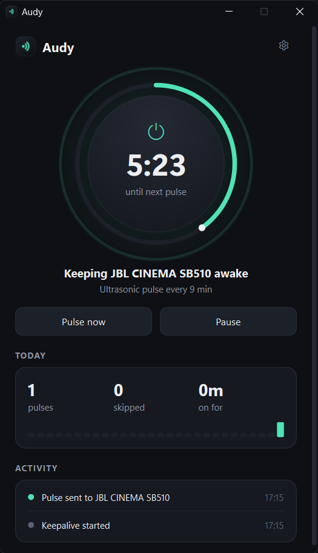
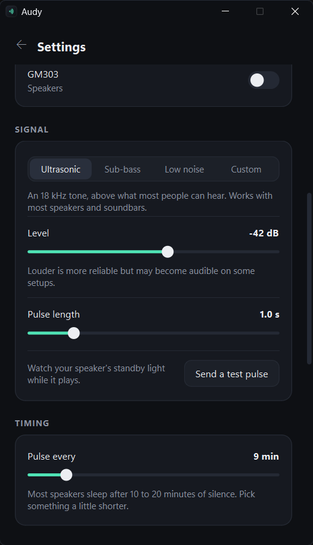

<p align="center">
  
  &nbsp;&nbsp;
  
</p>

<h1 align="center">Audy</h1>

<p align="center">Stop your speakers from falling asleep.</p>

Lots of soundbars, powered speakers and amps switch themselves off after a few minutes of
silence, then clip the start of the next sound while they wake up. Audy sends a short,
inaudible pulse of audio on a schedule so they stay on, and gets out of the way when
something else is already playing.

Windows 10 and 11.

## Features

- **Scheduled pulses.** Every 1 to 60 minutes (default 9). Each pulse fades in and out, so it doesn't click.
- **Pick the signal.** Ultrasonic (18 kHz), sub-bass (20 Hz), very quiet noise for optical and HDMI
  inputs, or a custom frequency. Level and pulse length are adjustable, and there's a test button.
- **Pick the speakers.** Keep one or several outputs awake at once, or just follow the system default.
- **Skips when it isn't needed.** If a device is already playing audio, Audy doesn't pulse it.
- **Active hours.** Keep speakers awake during the day and let them sleep overnight.
- **Pause** for 15 minutes to 4 hours from the window or the tray.
- **Activity log** with today's pulses, skips and any devices that couldn't be reached.
- **Runs in the tray.** Starts with Windows, turns keepalive back on if it was on when you quit,
  and can optionally keep the PC from sleeping while it runs.

## Install

Download `Audy.exe` from [Releases](https://github.com/IAmLaegion/Audy/releases), or build it yourself (see [Build](#build)).
There's no installer; put the exe wherever you like. If you turn on **Start with Windows**,
open Audy once again after moving the exe so the startup entry points to its new location.

Settings are stored in `%APPDATA%\Audy\settings.json`.

## Which signal should I use?

| Signal | Use it when |
| --- | --- |
| Ultrasonic | The default. Works with most speakers and soundbars. |
| Sub-bass | Your speaker or an audio enhancer filters out high frequencies. |
| Low noise | You're connected over optical or HDMI and the input wakes on any signal. |
| Custom | None of the above work for your setup. |

If a pulse doesn't keep your speaker awake, try raising the level a few dB, or pick the speaker
directly instead of **System default**. Apps that process audio, such as FxSound or equalizers,
can filter the pulse out before it reaches the speaker.

## Run from source

Requires Python 3.10 or newer.

```
pip install -r requirements.txt
python main.py
```

`python main.py --tray` starts hidden in the tray, which is what the Windows startup entry uses.

## Build

```
build.bat
```

This installs dependencies, renders the icon (`tools/make_icon.py`) and builds a single-file
`dist/Audy.exe` with PyInstaller.

## Project layout

| Path | What's in it |
| --- | --- |
| `audy/engine.py` | Scheduling, skip logic, active hours, pause, event log |
| `audy/audio.py` | Device discovery (WASAPI), signal synthesis, playback, level metering |
| `audy/window.py` | Home and settings screens |
| `audy/widgets.py` | Custom-drawn dial, switches and segmented control |
| `audy/tray.py` | Tray icon and menu |
| `audy/platform_win.py` | Title bar styling, startup entry, keep-awake |
| `audy/config.py` | Settings defaults, loading and saving |
| `tools/make_icon.py` | Renders `assets/audy.ico` |

Built with PySide6, sounddevice, NumPy and pycaw.

Audy was previously called Standby Preventer. On first run it imports that app's settings and
replaces its startup entry.

## License

[MIT](LICENSE)
